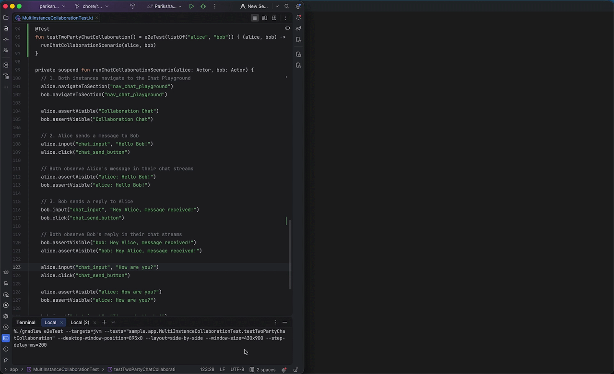
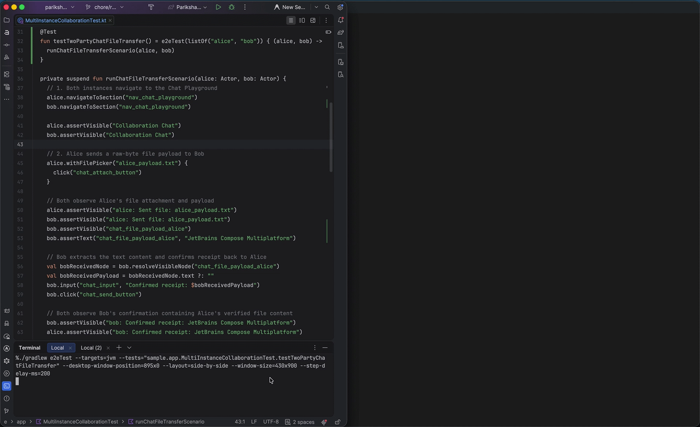
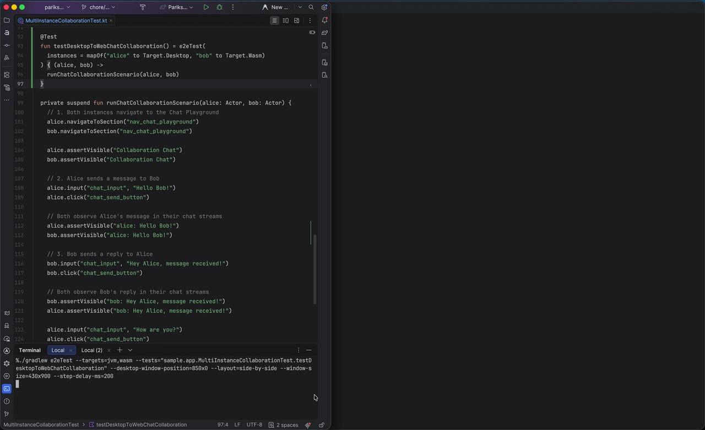

# Testing Multi-User and Cross-Platform Flows in Parikshan 0.1.0

Most UI tests verify a single user clicking through screens in isolation. Real bugs often happen when two users interact at the same time — a message sent from Desktop needs to render on Web, a file attachment needs to arrive intact, or a checkout on one client needs to mark an item out of stock on another.

Parikshan `0.1.0` adds multi-instance and multi-target orchestration for Desktop (JVM) and Web (Wasm) so you can drive multiple actors inside a single Kotlin test.

<!-- more -->

---

## Same Platform, Multiple Actors (Multi-Instance)

Pass actor names to `e2eTest`. Each actor handle is an `Actor` (a typealias for `E2ETestScope`), destructurable up to 5 actors:

```kotlin
@Test
fun testTwoPartyChatCollaboration() = e2eTest("alice", "bob") { (alice, bob) ->
  alice.click("nav_chat_playground")
  bob.click("nav_chat_playground")

  alice.input("chat_input", "Hello Bob!")
  alice.click("chat_send_button")

  alice.assertVisible("alice: Hello Bob!")
  bob.assertVisible("alice: Hello Bob!")

  bob.input("chat_input", "Hey Alice, message received!")
  bob.click("chat_send_button")

  bob.assertVisible("bob: Hey Alice, message received!")
  alice.assertVisible("bob: Hey Alice, message received!")
}
```

What runs underneath depends on the target:

* **Desktop (JVM)**: Parikshan spawns an isolated JVM process per actor on an ephemeral port with its own data directory (`System.getProperty("parikshan.data.dir")`) and actor identifier (`System.getProperty("parikshan.instance.id")`). Under `e2eTest`, secondary windows launch just in time for multi-instance classes and shut down immediately afterward.
* **Web (Wasm)**: Parikshan opens a fresh Playwright `BrowserContext` per actor per test against the local Wasm server, isolating cookies, `localStorage`, and `sessionStorage`. Actor identity is passed via `?parikshan_instance=<actor>`.

```bash
# Two Desktop windows side by side
./gradlew e2eTest --targets=jvm \
  --tests="sample.app.MultiInstanceCollaborationTest.testTwoPartyChatCollaboration" \
  --desktop-window-position=895x0 \
  --layout=side-by-side \
  --window-size=430x900 \
  --step-delay-ms=200
```



### Multi-Instance with File Picker Automation

`withFilePicker` also works per actor, so one Desktop instance can attach a fixture file while the other reads and confirms its payload:

```bash
./gradlew e2eTest --targets=jvm \
  --tests="sample.app.MultiInstanceCollaborationTest.testTwoPartyChatFileTransfer" \
  --desktop-window-position=895x0 \
  --layout=side-by-side \
  --window-size=430x900 \
  --step-delay-ms=200
```



---

## Desktop + Web in One Test (Multi-Target)

To run one actor on Desktop and another on Web inside the same scenario, map actor names to `Target.Desktop` and `Target.Wasm`:

```kotlin
@Test
fun testDesktopToWebChatCollaboration() = e2eTest(
  instances = mapOf("alice" to Target.Desktop, "bob" to Target.Wasm)
) { (alice, bob) ->
  alice.click("nav_chat_playground")
  bob.click("nav_chat_playground")

  alice.input("chat_input", "Hello Bob!")
  alice.click("chat_send_button")
  bob.assertVisible("alice: Hello Bob!")

  bob.input("chat_input", "Hey Alice, message received!")
  bob.click("chat_send_button")
  alice.assertVisible("bob: Hey Alice, message received!")
}
```

Run it with both targets side by side:

```bash
./gradlew e2eTest --targets=jvm,wasm \
  --tests="sample.app.MultiInstanceCollaborationTest.testDesktopToWebChatCollaboration" \
  --desktop-window-position=850x0 \
  --layout=side-by-side \
  --window-size=430x900 \
  --step-delay-ms=200
```



Because the `--tests` filter matches only a multi-target method, Gradle skips the redundant single-target Desktop and Wasm passes and runs only the cross-target batch:

```text
Parikshan: Test filter matches only multi-target method(s); skipping redundant single-target passes.
Parikshan [multi-target]: Spawning desktop instance(s) for: [alice]
Parikshan [multi-target]: Running sample.app.MultiInstanceCollaborationTest...

[MULTI-TARGET] SUCCESS - 1 test passed. (19s)
```

The same cross-target pattern works with `withFilePicker` (`testDesktopToWebChatFileTransfer`), where Desktop intercepts the AWT file dialog and Web intercepts Chromium's file chooser inside the same test.

---

## Full-Stack Example: Live Inventory Sync Against Ktor

In `samples/cmp-latest`, Alice (Desktop) and Bob (Web) connect to a real Ktor backend (`:server`) where a product starts with `Stock: 2`. Alice checks out twice while Bob refreshes the catalog after each purchase to verify `Stock: 1` and then `Out of Stock`:

```kotlin
@Test
fun testStorefrontDesktopToWebInventorySync() = e2eTest(
  instances = mapOf("alice" to Target.Desktop, "bob" to Target.Wasm)
) { (alice, bob) ->
  runStorefrontInventoryScenario(alice, bob, productId = "p1")
}
```

Extracting the scenario steps into a `suspend` function taking `(alice: Actor, bob: Actor)` lets the exact same flow run as Desktop+Desktop, Web+Web, and Desktop+Web without duplicating assertions.

---

## Tradeoffs & Known Limitations in 0.1.0

* **Desktop & Web only in `0.1.0`**: Multi-instance and multi-target orchestration support Desktop (JVM) and Web (Wasm). `e2eTest(listOf(...))` tests in `commonTest` are skipped (`TestAbortedException`) during `e2eAndroidTest` and `e2eIosTest`; explicit `Target.Android` or `Target.Ios` in `mapOf(...)` fails fast. Mobile multi-target orchestration is planned for `0.2.0`.
* **Build-time literal discovery**: Gradle scans `commonTest` and `jvmTest` source files before launching processes, so actor names must be passed as string literals in `e2eTest(...)` rather than computed variables.
* **Desktop process reuse vs. Wasm clean context**: Desktop actors keep their process alive between methods in a class, while Wasm actors get a fresh `BrowserContext` per method. Reset backend fixtures and Desktop UI state explicitly between tests.
* **Video recording skipped**: Video capture is skipped during multi-instance and multi-target runs in `0.1.0` (single-instance video recording works as before).
* **Dedicated test classes**: `E2ETestLifecycle` (`beforeEach` / `afterEach`) applies only to single-instance `e2eTest { ... }` in `0.1.0`. Keep multi-actor tests in separate classes and use `@BeforeTest` / `@AfterTest` plus `suspend` helpers.

---

## Upgrading to 0.1.0

```kotlin
plugins {
  id("io.github.aryapreetam.parikshan") version "0.1.0"
}
```

See the [Multi-Instance Guide](../../features/multi-instance.md) and [Multi-Target Guide](../../features/multi-target.md) for setup details, or open an issue on GitHub if you hit an edge case.
