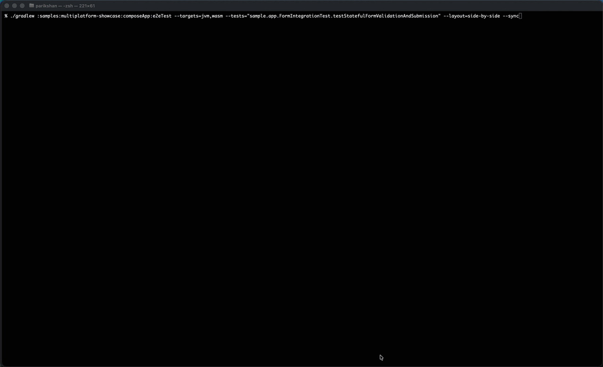
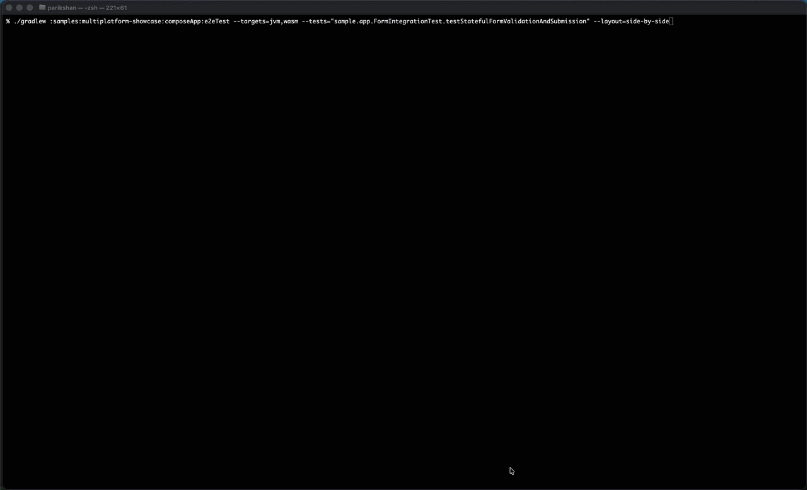

# Synchronized Multi-Target Execution (`--sync`)

When running tests across Android, iOS, Desktop, and Web concurrently, platforms naturally execute at different speeds. Desktop JVM tests typically execute within seconds, while mobile emulators and browser engines process transitions and layout passes at different cadences.

Parikshan's synchronized execution mode (`--sync`) introduces a step-barrier lockstep engine that coordinates actions across all active targets simultaneously.

---

## How It Works

When `--sync` is enabled:
1. The test runner boots all requested target applications in parallel.
2. Every test command (`click`, `input`, `drag`, `scroll`) is dispatched to all targets simultaneously using `BroadcastDriver`.
3. The runner waits for all targets to confirm completion of the current step before advancing to the next.
4. If an assertion or action fails on any target, the runner reports the failing target and captures relevant diagnostic logs.

=== "Synchronized Lockstep (`--sync`)"
    ```bash
    ./gradlew :samples:multiplatform-showcase:composeApp:e2eTest \
      --targets=jvm,wasm \
      --tests="sample.app.FormIntegrationTest.testStatefulFormValidationAndSubmission" \
      --layout=side-by-side \
      --sync
    ```

    

=== "Asynchronous Execution (Default)"
    ```bash
    ./gradlew :samples:multiplatform-showcase:composeApp:e2eTest \
      --targets=jvm,wasm \
      --tests="sample.app.FormIntegrationTest.testStatefulFormValidationAndSubmission" \
      --layout=side-by-side
    ```

    

---

## Running Synchronized Tests

Pass the `--sync` flag along with two or more targets to the unified `e2eTest` task:

```bash
# Run Desktop and Web in synchronized lockstep
./gradlew e2eTest --targets=jvm,wasm --tests="sample.app.FormIntegrationTest" --sync

# Combine with side-by-side layout for visual comparison
./gradlew e2eTest \
  --targets=jvm,wasm \
  --tests="sample.app.FormIntegrationTest" \
  --layout=side-by-side \
  --sync
```

### Full Multiplatform Lockstep

Drive Desktop, Web, Android, and iOS simultaneously from a single test invocation:

```bash
./gradlew e2eTest --targets=desktop,wasm,android,ios --sync
```

---

## Key Considerations

* **Deterministic Step Barriers:** Because each step waits for the slowest platform to finish, synchronized runs take as long as the slowest active target.
* **Uniform Assertions:** Synchronized tests execute the exact same command block across all targets. If your UI has target-specific variants, use platform conditionals (`isWasm()`, `isDesktop()`, `isAndroid()`, `isIos()`) inside the test.
* **Video Recording:** Video recording is disabled during `--sync` mode to prevent synchronization delays from affecting recorded timing.
