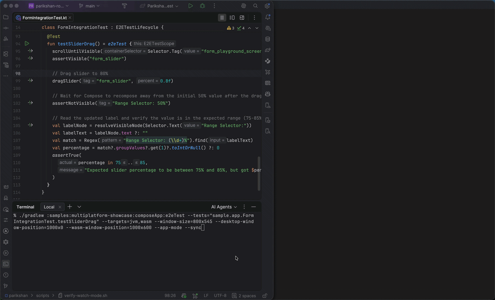
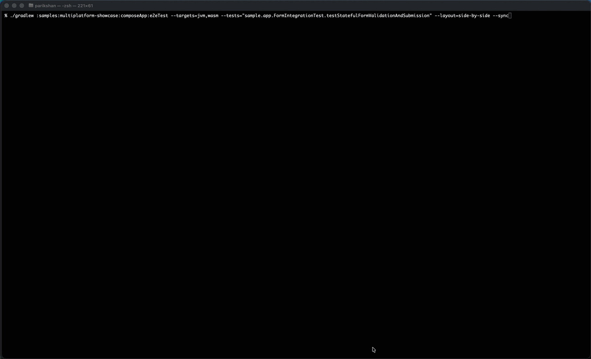
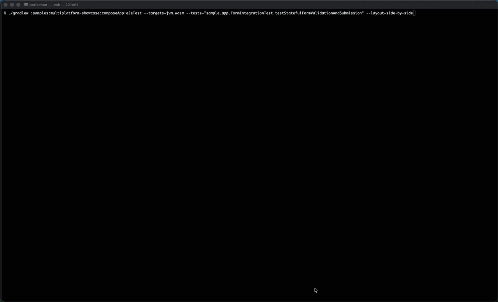
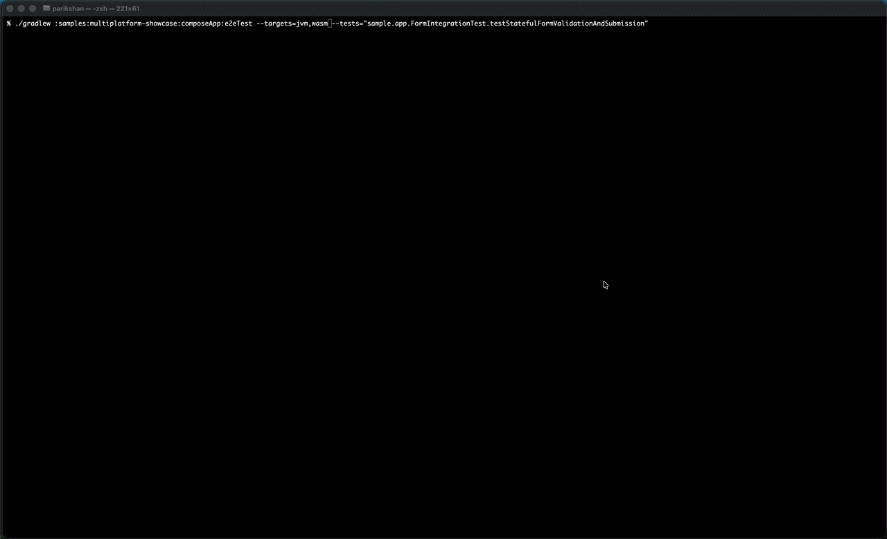
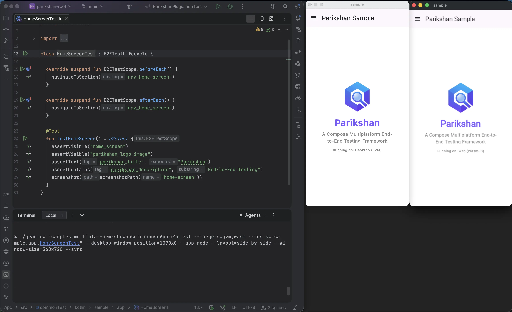

# Window Layout & Sizing (JVM & Wasm)

During local test development and visual inspection, windows defaulting to the screen center can overlap your IDE or terminal. Parikshan provides granular command-line controls to specify window dimensions, screen placement coordinates, and automated side-by-side tiling for Desktop (JVM) and Web (Wasm) targets.

> [!NOTE]
> Window sizing and positioning flags apply to Desktop (JVM) and Web (WasmJs) targets. Mobile emulators and iOS simulators operate with fixed OS viewport dimensions.

---

## Window Sizing

You can specify global dimensions applied uniformly to both Desktop and Web, or configure each target independently:

```bash
# Uniform mobile-dimension viewport (360x720) across Desktop and Web
./gradlew e2eTest --targets=jvm,wasm --window-size=360x720

# Independent sizing per target
./gradlew e2eTest \
  --targets=jvm,wasm \
  --desktop-window-size=400x800 \
  --wasm-window-size=600x900
```

---

## Screen Placement & Coordinates

Control the exact screen coordinates (`<x>,<y>` or `<x>x<y>`) where each window opens:

```bash
./gradlew :samples:multiplatform-showcase:composeApp:e2eTest \
  --tests="sample.app.FormIntegrationTest.testSliderDrag" \
  --targets=jvm,wasm \
  --window-size=800x545 \
  --desktop-window-position=1000x0 \
  --wasm-window-position=1000x600 \
  --app-mode \
  --sync
```



---

## Side-by-Side Layout (`--layout=side-by-side`)

The `--layout=side-by-side` option automatically tiles Desktop and Web windows adjacent to each other on your screen:

=== "Side-by-Side with Sync"
    ```bash
    ./gradlew :samples:multiplatform-showcase:composeApp:e2eTest \
      --targets=jvm,wasm \
      --tests="sample.app.FormIntegrationTest.testStatefulFormValidationAndSubmission" \
      --layout=side-by-side \
      --sync
    ```

    

=== "Side-by-Side without Sync"
    ```bash
    ./gradlew :samples:multiplatform-showcase:composeApp:e2eTest \
      --targets=jvm,wasm \
      --tests="sample.app.FormIntegrationTest.testStatefulFormValidationAndSubmission" \
      --layout=side-by-side
    ```

    

=== "Default Placement (Without Side-by-Side)"
    ```bash
    ./gradlew :samples:multiplatform-showcase:composeApp:e2eTest \
      --targets=jvm,wasm \
      --tests="sample.app.FormIntegrationTest.testStatefulFormValidationAndSubmission"
    ```

    

---

## Docking Windows Alongside Your IDE

To position tiled mobile-sized windows next to your IDE workspace without window overlap, combine positioning, sizing, standalone app mode, and side-by-side tiling:

```bash
./gradlew :samples:multiplatform-showcase:composeApp:e2eTest \
  --targets=jvm,wasm \
  --tests="sample.app.HomeScreenTest" \
  --desktop-window-position=1070x0 \
  --app-mode \
  --layout=side-by-side \
  --window-size=360x720 \
  --sync
```



---

## Standalone App Mode for Web

By default, Wasm tests launch in a standard browser window with navigation bars. Passing `--app-mode` launches Chromium in standalone application mode, hiding the URL address bar, navigation buttons, and tab strip for a clean application viewport:

```bash
# Standard browser window
./gradlew e2eTest --targets=wasm --tests="sample.app.HomeScreenTest"

# Standalone app window
./gradlew e2eTest --targets=wasm --tests="sample.app.HomeScreenTest" --app-mode
```

<table class="demo-table">
  <thead>
    <tr>
      <th>Standard Browser Viewport</th>
      <th>Standalone Application Viewport (<code>--app-mode</code>)</th>
    </tr>
  </thead>
  <tbody>
    <tr>
      <td></td>
      <td></td>
    </tr>
  </tbody>
</table>
