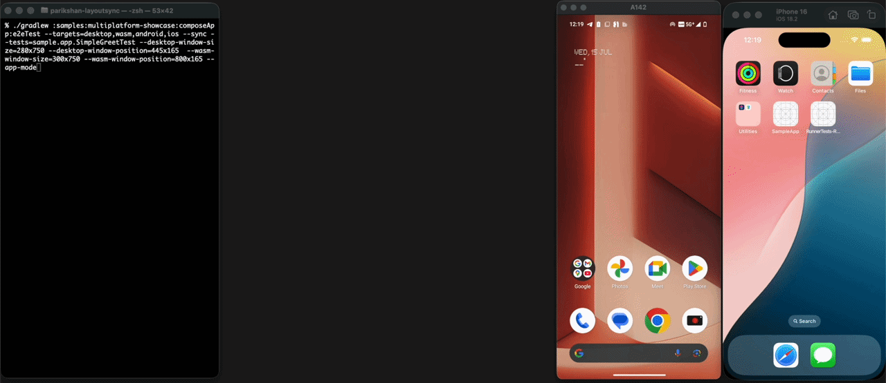
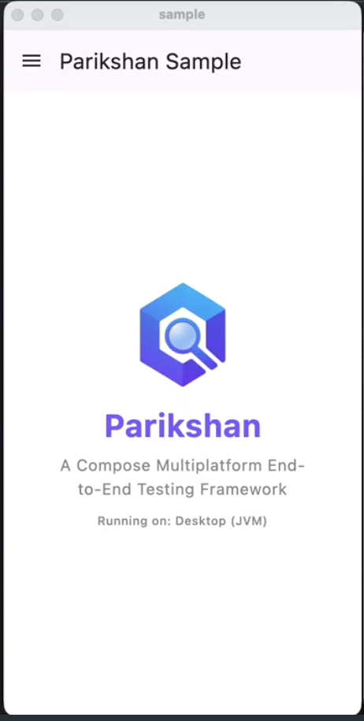
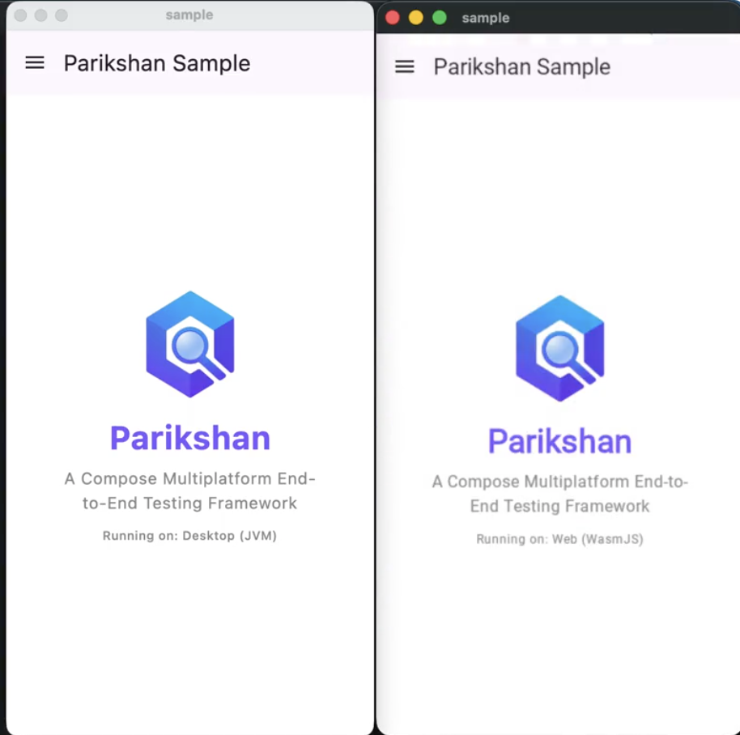

<h1 align="center" style="border-bottom: none; margin-top: 0;">
  
  <span style="vertical-align: middle; margin-left: 8px;">Parikshan</span>
</h1>

<p align="center">End-to-End testing framework for Compose Multiplatform</p>

<p align="center">
  <a href="https://github.com/aryapreetam/parikshan/actions/workflows/release.yml">
    
  </a>
  <a href="https://mvnrepository.com/artifact/io.github.aryapreetam.parikshan/parikshan">
    
  </a>
  <a href="https://github.com/aryapreetam/parikshan/actions/workflows/push-ci.yml">
    
  </a>
  <a href="https://kotlinlang.org/docs/components-stability.html">
    
  </a>
</p>

<p align="center">
  
  <br/>
  <span style="font-size: 0.78em; opacity: 0.85;"><em>Synchronized multi-target execution (<code>--sync</code>) driving Desktop, Web (<code>--app-mode</code>), Android, and iOS in lockstep from a single test.</em></span>
</p>

### Features

- Write tests in Kotlin, execute and visually watch them run across Android, iOS, Desktop, and Web (Wasm).
- [Multi-instance](features/multi-instance.md) and [multi-target](features/multi-target.md) orchestration for collaborative multi-user testing.
- Built-in [file picker automation](features/file-picker.md), [synchronized execution](features/synchronized-execution.md), [window layout & sizing](features/window-layout.md), [continuous watch mode](features/watch-mode.md), screenshot capture, and [video reports](features/test-reports.md).

[**API Reference**](https://aryapreetam.github.io/parikshan/api/) | [**Quickstart Guide**](getting-started/quickstart.md) | [**Features Hub**](features/index.md) | [**Examples**](examples.md)

---

## Quick Start

### 1. Apply the Plugin
In your shared library module (e.g. `:composeApp`) `build.gradle.kts`:

```kotlin
plugins {
  id("io.github.aryapreetam.parikshan") version "0.0.13"
}
```

### 2. Write your test
Create your test in `src/commonTest/kotlin`:

=== "Standard"

    <div class="code-preview-grid" markdown="1">

    <div class="code-column" markdown="1">

    ```kotlin
    package sample.app

    import io.github.aryapreetam.parikshan.e2eTest
    import kotlin.test.Test

    class SimpleGreetTest {
      @Test
      fun testSimpleGreeting() = e2eTest {
        // enter text in component tagged name_input
        input("name_input", "परिक्षण")

        // click button with text 'Greet!'
        click("Greet!")

        // verify greeting is displayed
        assertVisible("Hello, परिक्षण!")
      }
    }
    ```

    **Run on any platform:**
    ```bash
    ./gradlew e2eAndroidTest
    ./gradlew e2eIosTest
    ./gradlew e2eDesktopTest # or ./gradlew e2eJvmTest
    ./gradlew e2eWasmTest

    # Or run across multiple targets simultaneously
    ./gradlew e2eTest --targets=desktop,wasm,android,ios
    ```

    </div>

    <div class="preview-column" markdown="1">

    

    </div>

    </div>

=== "Multi-Instance"

    <div class="code-preview-grid" markdown="1">

    <div class="code-column" markdown="1">

    ```kotlin
    package sample.app

    import io.github.aryapreetam.parikshan.e2eTest
    import kotlin.test.Test

    class MultiInstanceCollaborationTest {
      @Test
      fun testTwoPartyChatCollaboration() = e2eTest(listOf("alice", "bob")) { (alice, bob) ->
        // Alice sends a message
        alice.input("chat_input", "Hello Bob!")
        alice.click("chat_send_button")

        // Bob verifies receipt and replies
        bob.assertVisible("alice: Hello Bob!")
        bob.input("chat_input", "Hey Alice, message received!")
        bob.click("chat_send_button")

        // Alice verifies receipt
        alice.assertVisible("bob: Hey Alice, message received!")
      }
    }
    ```

    **Run multiple instances (Desktop or Web):**
    ```bash
    ./gradlew e2eDesktopTest --tests="sample.app.MultiInstanceCollaborationTest"
    ./gradlew e2eWasmTest --tests="sample.app.MultiInstanceCollaborationTest"
    ```

    </div>

    <div class="preview-column" markdown="1">

    

    </div>

    </div>

=== "Multi-Target"

    <div class="code-preview-grid" markdown="1">

    <div class="code-column" markdown="1">

    ```kotlin
    package sample.app

    import io.github.aryapreetam.parikshan.Target
    import io.github.aryapreetam.parikshan.e2eTest
    import kotlin.test.Test

    class MultiTargetCollaborationTest {
      @Test
      fun testDesktopToWebChat() = e2eTest(
        instances = mapOf("alice" to Target.Desktop, "bob" to Target.Wasm)
      ) { (alice, bob) ->
        // Alice on Desktop sends a message
        alice.input("chat_input", "Hello from Desktop!")
        alice.click("chat_send_button")

        // Bob on Web verifies receipt and replies
        bob.assertVisible("alice: Hello from Desktop!")
        bob.input("chat_input", "Hey Alice, received on Web!")
        bob.click("chat_send_button")

        // Alice on Desktop verifies receipt
        alice.assertVisible("bob: Hey Alice, received on Web!")
      }
    }
    ```

    **Run cross-target test (Desktop + Web):**
    ```bash
    ./gradlew e2eTest --targets=jvm,wasm --tests="sample.app.MultiTargetCollaborationTest"
    ```

    </div>

    <div class="preview-column" markdown="1">

    

    </div>

    </div>

=== "File Picker"

    <div class="code-preview-grid" markdown="1">

    <div class="code-column" markdown="1">

    ```kotlin
    package sample.app

    import io.github.aryapreetam.parikshan.e2eTest
    import kotlin.test.Test

    class FileUploadTest {
      @Test
      fun testDocumentUpload() = e2eTest {
        withFilePicker("report.pdf") {
          click("upload_button")
        }
        assertVisible("report.pdf uploaded")
      }
    }
    ```

    **Run on any platform:**
    ```bash
    ./gradlew e2eDesktopTest
    ./gradlew e2eWasmTest
    ./gradlew e2eAndroidTest
    ./gradlew e2eIosTest
    ```

    </div>

    <div class="preview-column" markdown="1">

    

    </div>

    </div>

> **Note:** For projects configuring `jvm()` or `jvm("desktop")`, both `e2eDesktopTest` and `e2eJvmTest` are registered as full Gradle `Test` tasks supporting `--tests`. Custom JVM target names (such as `jvm("custom")`) register `e2eCustomTest`. The unified `e2eTest` task accepts both `--targets=desktop` and `--targets=jvm`.

---

## Examples & Demos

Explore working integration samples and video recordings across all platforms in the [Examples](examples.md) section.
